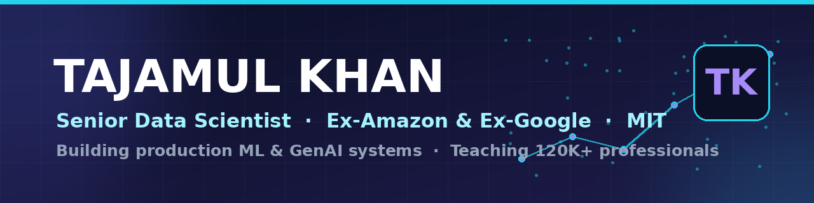

<!-- PROFILE BANNER — repo asset me host kiya (permanent URL, kabhi expire nahi hota) -->

  

<h1 align="center">Hi, I'm Tajamul Khan 👋</h1>

<h3 align="center">Senior Data Scientist · Ex-Amazon & Ex-Google · MIT</h3>

  I build production-grade <b>Machine Learning & Generative AI</b> systems and teach <b>120,000+ professionals</b> how to do the same — through real projects, 1:1 mentorship, and content.

## 🚀 What I Do

- **Build** — production ML, Deep Learning & GenAI systems (Python · PyTorch · TensorFlow · Azure · GCP)
- **Teach** — 1:1 mentorship, MAANG interview prep, portfolio & resume reviews
- **Write** — ebooks & articles on ML, SQL, Power BI & AI engineering

## ⭐ Featured Work

| Project | What it is | Why it matters |
|---|---|---|
| [Machine-Learning-Projects](https://github.com/tajamulkhann/Machine-Learning-Projects) | 80+ real ML projects — supervised & unsupervised | My flagship repo · **57★** · used by learners worldwide |
| [Generative-AI-Projects](https://github.com/tajamulkhann/Generative-AI-Projects) | Hands-on GenAI: LLMs, RAG & agents | The stack every company is hiring for right now |
| [Deep-Learning-Projects](https://github.com/tajamulkhann/Deep-Learning-Projects) | Real DL projects, layer by layer | Neural networks beyond theory |
| [NLP-Projects](https://github.com/tajamulkhann/NLP-Projects) | Language data projects & experiments | Text is the new SQL |
| [Statistical-Analysis-Projects](https://github.com/tajamulkhann/Statistical-Analysis-Projects) | Statistics & EDA done properly | The math behind every model |
| [My Portfolio](https://tajamulkhann.github.io) | Live portfolio site | See my work in action |

## 🛠️ Tech Stack

  
  
  
  
  
  
  
  
  
  
  
  

## 📊 GitHub Stats

  
  

  

## 📬 Let's Connect

  
  
  
  
  
  

---

💬 **Mentorship & career help** — resume reviews, mock interviews, MAANG prep: [Book a call](https://topmate.io/tajamulkhan)

⚡ **Open to AI/ML roles & collaborations** — let's build something great.
